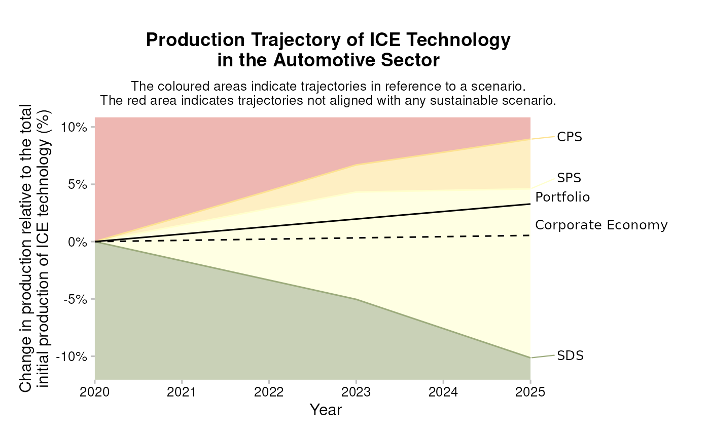
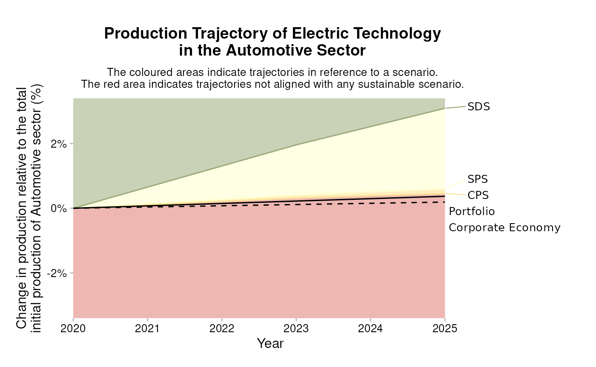
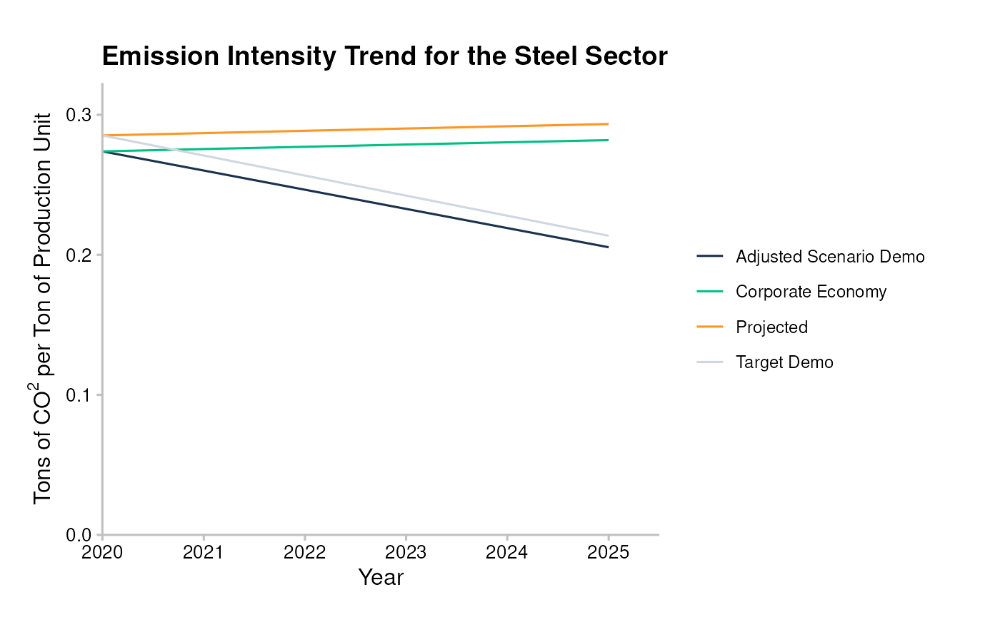

# Metrics

## Market Share Approach

The Market Share Approach is used for allocating scenario efforts and to
show how to calculate the market-share target for a given scenario.

### Scenario market-shares

Say that you want to study how a portfolio would perform in a specific
climate scenario. How can you allocate scenario efforts to the
production profile of your portfolio? You can do that in at least two
ways – by technology, or by sector.

#### 1. Market-share by technology

We define the market-share by technology as:

$$p_{i}^{tmsr}(t) = p_{i}\left( t_{0} \right) + p_{i}\left( t_{0} \right)*\frac{s_{i}(t) - s_{i}\left( t_{0} \right)}{s_{i}\left( t_{0} \right)}$$

We can see that this reduces to:

\$\$p\_{i}^{tmsr}(t) = p\_{i}(t\_{0}) \left(1 + \frac{s_i(t) -
s\_{i}(t_0)}{s_i(t_0)} \right) \\ p\_{i}^{tmsr}(t) = p\_{i}(t\_{0})
\left(1 + \frac{s_i(t)}{s_i(t_0)} -1 \right) \\ p\_{i}^{tmsr}(t) =
p\_{i}(t\_{0}) \* \frac{s_i(t)}{s_i(t_0)}\$\$

where:

- $s_{i}(t)$ is the scenario production for technology $i$ at time $t$,
- $p_{i}\left( t_{0} \right)$ is the production allocated to the
  portfolio for some technology, $i$ at time $t_{0}$, and
- $p_{i}^{tmsr}(t)$ is the portfolio-specific target production for that
  technology.

We define the “Technology Market Share Ratio” as:

$$\frac{s_{i}(t)}{s_{i}\left( t_{0} \right)}$$ This method is used to
set targets for “decreasing” (i.e. brown) technologies.

Below you can see an example of how the market share approach is
illustrated for a portfolio with exposure to companies that produce
vehicles with internal combustion engines (ICE), a high-carbon
technology that is expected to decrease in climate-ambitious scenarios.
The lines separating the colors reflect the Target Market Share Ratio
($p_{i}^{tmsr}(t)$) for ICE vehicles for the portfolio as defined above.
The most ambitious scenario in this example is the SDS scenario, which
describes a decreasing amount of ICE production over time, in line with
the expectations for a high-carbon technology.



#### 2. Market-share by sector

To calculate the market-share by sector, we use the initial production
of both the portfolio and scenario at the sector-level instead.
$$p_{i}^{smsp}(t) = p_{i}\left( t_{0} \right) + P\left( t_{0} \right)*\left( \frac{s_{i}(t) - s_{i}\left( t_{0} \right)}{S\left( t_{0} \right)} \right)$$
where:

- $P_{i}\left( t_{0} \right)$ is the portfolio’s total production in the
  sector at $t_{0}$, and
- $S\left( t_{0} \right)$ is the scenario total production at $t_{0}$.

We define the “Sector Market Share Percentage” as:

$$\frac{s_{i}(t) - s_{i}\left( t_{0} \right)}{S\left( t_{0} \right)}$$
This method is used to calculate targets for “increasing” (i.e. green)
technologies.

Below you can see an example of how the market share approach is
illustrated for a portfolio with exposure to companies that produce
electric vehicles, a low-carbon technology that is expected to increase
in climate-ambitious scenarios. The lines separating the colors reflect
the Sector Market Share Percentage ($p_{i}^{smsp}(t)$) for electric
vehicles for the portfolio as defined above. The most ambitious scenario
in this example is the SDS scenario, which describes an increasing
amount of electric vehicle production over time, in line with the
expectations for a high-carbon technology.



### Overview of increasing and decreasing technologies

As stated above, the decision to use the technology market share ratio
(TMSR) or the sector market share percentage (SMSP) depends on whether
the technology in question is increasing or decreasing in the scenario.
Generally, low-carbon or “green” technologies are treated as increasing
technologies and high-carbon or “brown” technologies are treated as
decreasing technologies. The table below summarizes the technologies and
their expected behavior in the scenarios.

Overview of Increasing and Decreasing Technologies

Technologies mapped to appropriate market share approach

### How to calculate market-share targets for a given scenario

To calculate market-share targets, you need to use the package
[pacta.loanbook](https://rmi-pacta.github.io/pacta.loanbook/) and a
number of datasets, including a “matched” dataset (loanbook +
asset-level data) that you can get by following the [Matching
Process](https://rmi-pacta.github.io/pacta.loanbook/dev/articles/cookbook_running_the_analysis.html#matching-process)
section of the [Running the
Analysis](https://rmi-pacta.github.io/pacta.loanbook/dev/articles/cookbook_running_the_analysis.md)
chapter of the cookbook. The datasets used here are included in the
[pacta.loanbook](https://rmi-pacta.github.io/pacta.loanbook/) package;
they are fake but show how you should structure your own data.

- Load the package.

``` r
library(pacta.loanbook)
library(dplyr)  # for `%>%`
```

- Match the loanbook to asset level data.

``` r
loanbook <- loanbook_demo
abcd <- abcd_demo

matched <- match_name(loanbook = loanbook, abcd = abcd) %>%
  # WARNING: Remember to validate the output of match_name() before prioritize()
  prioritize()

matched
#> # A tibble: 177 × 22
#>    id_loan id_direct_loantaker name_direct_loantaker              id_ultimate_parent name_ultimate_parent             loan_size_outstanding loan_size_outstanding_currency loan_size_credit_limit loan_size_credit_limit_currency sector_classification_system sector_classification_direc…¹ lei_direct_loantaker isin_direct_loantaker id_2dii level sector sector_abcd name  name_abcd score source borderline
#>    <chr>   <chr>               <chr>                              <chr>              <chr>                                            <dbl> <chr>                                           <dbl> <chr>                           <chr>                        <chr>                         <chr>                <chr>                 <chr>   <chr> <chr>  <chr>       <chr> <chr>     <dbl> <chr>  <lgl>     
#>  1 L6      C304                Kassulke-Kassulke                  UP83               Farrell, Farrell and Farrell                    185721 EUR                                          18570711 EUR                             NACE                         D35.11                        108200TUBGG1DR0QR635 NA                    DL129   dire… power  power       Kass… Kassulke…     1 loanb… FALSE     
#>  2 L13     C297                Ladeck                             UP69               Kuhlman-Kuhlman                                 200569 EUR                                          18718839 EUR                             NACE                         D35.11                        948400P8YHB5DZHF3869 NA                    DL144   dire… power  power       Lade… Ladeck        1 loanb… FALSE     
#>  3 L20     C287                Weinhold                           UP35               Heinz                                           308217 EUR                                          19792767 EUR                             NACE                         D35.11                        NA                   NA                    DL270   dire… power  power       Wein… Weinhold      1 loanb… FALSE     
#>  4 L21     C286                Gallo Group                        UP63               Giordano Group                                  226553 EUR                                          18978063 EUR                             NACE                         D35.11                        961100AOJ8SCT439AL00 NA                    DL86    dire… power  power       Gall… Gallo Gr…     1 loanb… FALSE     
#>  5 L22     C285                Austermuhle GmbH                   UP187              Hickle-Hickle                                   196857 EUR                                          18681807 EUR                             NACE                         D35.11                        NA                   NA                    DL5     dire… power  power       Aust… Austermu…     1 loanb… FALSE     
#>  6 L24     C282                Ferraro-Ferraro Group              UP209              NA                                              309145 EUR                                          19802025 EUR                             NACE                         D35.11                        NA                   NA                    DL80    dire… power  power       Ferr… Ferraro-…     1 loanb… FALSE     
#>  7 L25     C281                Lockman, Lockman and Lockman       UP296              Butte                                           266457 EUR                                          19376157 EUR                             NACE                         D35.11                        6700006IJUUQG37Y4004 NA                    DL150   dire… power  power       Lock… Lockman,…     1 loanb… FALSE     
#>  8 L26     C280                Ankunding, Ankunding and Ankunding UP67               De luca, De luca e De luca Group                199641 EUR                                                 0 EUR                             NACE                         D35.11                        NA                   NA                    DL3     dire… power  power       Anku… Ankundin…     1 loanb… FALSE     
#>  9 L27     C278                Donati-Donati Group                UP45               Christoph GmbH                                  197785 EUR                                                 0 EUR                             NACE                         D35.11                        463600EXRQBFGLX57N94 NA                    DL65    dire… power  power       Dona… Donati-D…     1 loanb… FALSE     
#> 10 L28     C276                Ferraro, Ferraro e Ferraro SPA     UP195              Franke Franke AG & Co. KG                       315641 EUR                                          -5000000 EUR                             NACE                         D35.11                        NA                   NA                    DL79    dire… power  power       Ferr… Ferraro,…     1 loanb… FALSE     
#> # ℹ 167 more rows
#> # ℹ abbreviated name: ¹​sector_classification_direct_loantaker
```

- Calculate market-share targets for production at the portfolio level.

``` r
# portfolio level targets
scenario <- scenario_demo_2020
regions <- region_isos_demo


matched %>%
  target_market_share(
    abcd = abcd,
    scenario = scenario,
    region_isos = regions
  )
#> # A tibble: 1,210 × 10
#>    sector     technology  year region scenario_source metric     production technology_share scope  percentage_of_initial_production_by_scope
#>    <chr>      <chr>      <int> <chr>  <chr>           <chr>           <dbl>            <dbl> <chr>                                      <dbl>
#>  1 automotive electric    2020 global demo_2020       projected     145649.            0.165 sector                                  0       
#>  2 automotive electric    2020 global demo_2020       target_cps    145649.            0.165 sector                                  0       
#>  3 automotive electric    2020 global demo_2020       target_sds    145649.            0.165 sector                                  0       
#>  4 automotive electric    2020 global demo_2020       target_sps    145649.            0.165 sector                                  0       
#>  5 automotive electric    2021 global demo_2020       projected     147480.            0.165 sector                                  0.000739
#>  6 automotive electric    2021 global demo_2020       target_cps    148314.            0.163 sector                                  0.00108 
#>  7 automotive electric    2021 global demo_2020       target_sds    161823.            0.167 sector                                  0.00653 
#>  8 automotive electric    2021 global demo_2020       target_sps    149035.            0.163 sector                                  0.00137 
#>  9 automotive electric    2022 global demo_2020       projected     149310.            0.165 sector                                  0.00148 
#> 10 automotive electric    2022 global demo_2020       target_cps    150923.            0.161 sector                                  0.00213 
#> # ℹ 1,200 more rows
```

- Calculate market-share targets for production at the company level.

``` r
matched %>%
  target_market_share(
    abcd = abcd,
    scenario = scenario,
    region_isos = regions,
    by_company = TRUE,
    weight_production = FALSE
  )
#> # A tibble: 37,349 × 11
#>    sector     technology  year region scenario_source name_abcd                      metric     production technology_share scope  percentage_of_initial_production_by_scope
#>    <chr>      <chr>      <int> <chr>  <chr>           <chr>                          <chr>           <dbl>            <dbl> <chr>                                      <dbl>
#>  1 automotive electric    2020 global demo_2020       Bahr                           projected           0                0 sector                                         0
#>  2 automotive electric    2020 global demo_2020       Bahr                           target_cps          0                0 sector                                         0
#>  3 automotive electric    2020 global demo_2020       Bahr                           target_sds          0                0 sector                                         0
#>  4 automotive electric    2020 global demo_2020       Bahr                           target_sps          0                0 sector                                         0
#>  5 automotive electric    2020 global demo_2020       Beier, Beier and Beier         projected           0                0 sector                                         0
#>  6 automotive electric    2020 global demo_2020       Beier, Beier and Beier         target_cps          0                0 sector                                         0
#>  7 automotive electric    2020 global demo_2020       Beier, Beier and Beier         target_sds          0                0 sector                                         0
#>  8 automotive electric    2020 global demo_2020       Beier, Beier and Beier         target_sps          0                0 sector                                         0
#>  9 automotive electric    2020 global demo_2020       Bellini, Bellini e Bellini SPA projected           0                0 sector                                         0
#> 10 automotive electric    2020 global demo_2020       Bellini, Bellini e Bellini SPA target_cps          0                0 sector                                         0
#> # ℹ 37,339 more rows
```

## Sectoral Decarbonization Approach

The Sectoral Decarbonization Approach (SDA) is a method for setting
corporate CO₂ emissions intensity reduction targets in line with climate
science. This method was developed by the Science-Based Targets
Initiative ([SBTI](https://sciencebasedtargets.org/)), an international
initiative on science-based target setting for companies.

In the context of PACTA, this methodology is used to calculate emission
factor targets for homogenous sectors (i.e. sectors with no
technology-level scenario pathways).

First, the distance, $d$, between the company’s CO₂ emissions intensity
per unit production (or emissions factor), $I^{Co}(t)$ at some base
year, $t_{0}$, and a scenario target intensity in 2050, $I^{Sc}(2050)$
is calculated. The target intensity in 2050 can be taken from any
relevant climate scenario:

$$d = I^{Co}\left( t_{0} \right) - I^{Sc}(2050)$$

The company’s market share parameter, $m(t)$, is defined as the
company’s expected future activity, $P^{Co}(t)$ divided by the sector’s
future activity, $P^{Sc}(t)$ to reflect the expected forward-looking
market share of the company. This is given as a ratio to the company’s
base year market share, derived from its activity,
$P^{Co}\left( t_{0} \right)$ divided by the sector’s activity in the
same year, $P^{Sc}\left( t_{0} \right)$. In both cases the former is
calculated per company, and the latter is determined from the climate
scenario:

$$m(t) = \frac{P^{Co}\left( t_{0} \right)/P^{Sc}\left( t_{0} \right)}{P^{Co}(t)/P^{Sc}(t)}$$

It should be noted that this parameter does not capture the change in
the market share of the company but rather the inverse. This is useful
as it equates to a decreasing parameter when the company’s market share
is increasing. This equates to larger reduction efforts when the
companies market share is increasing over time.

The sector decarbonization factor, $p(t)$ is defined as:

$$p(t) = \frac{I^{Sc}(t) - I^{Sc}(2050)}{I^{Sc}\left( t_{0} \right) - I^{Sc}(2050)}$$

where $I^{in}(t)$ and $I^{Sc}(t)$ are the average market and scenario
emission intensities respectively, at time $t$.

This variable captures the remaining effort needed from the market to
meet the target in 2050, per year. Under the SDA assumptions the CO₂
intensity for all companies in a sector converge in 2050. Note that
$p\left( t_{0} \right) = 1$ and $p(2050) = 0$, indicating that 100% of
the expected decarbonization efforts are still to be met at the base
year and 0% should be left at 2050.

The company-level emission intensity target is then defined as:
$$I^{Target}(t) = \left( d*p(t)*m(t) \right) + I^{Sc}(2050)$$

### PACTA Assumptions

The SDA applied in PACTA differs slightly from the way it is applied by
the SBTI. In particular, we must align the top-down approach laid out by
climate scenarios with the bottom-up asset-based company data used in
the PACTA analysis.

**Assumption: Market share stays constant ($m(t)$ = 1)**

Due to the lack of quantitative data on the expected market share
changes throughout the entire time horizon up to 2050. $m(t)$ is set to
1 for all years. Under the SBTI method for calculating $m(t)$, there
will be a higher intensity reduction target in cases where the absolute
pathway of the sector exceeds the scenario target. This makes sense.
However, applying this at company level is counter-intuitive:

> Companies that decrease their market share would be allowed to have a
> higher CO₂-Intensity than the average market actor. While, companies
> that are increasing their market share are forced to do more in terms
> of CO₂-Intensity than ones whose market share remains constant. It
> follows that if a company reaches the targeted CO₂-Intensity it would
> not be allowed to increase its share in the market. This is a
> desirable outcome.

Under this assumption, our target calculation reduces to:

$$I^{Target}(t) = \left( d*p(t) \right) + I^{Sc}(2050)$$

**Approximation: Adjust base year scenario emission intensity**

In both the SBTI and the PACTA methodology the target emissions for the
sector are taken from climate scenarios. These implement a global
economy top-down approach which applies an absolute emissions value in
the year 2050 and then converts this to yearly emission intensities.
However, there may be discrepancies between the Scenario projected
emission intensities, and the bottom-up ABCD emission intensities. To
reflect this discrepancy, we adjust the scenario projections by the
following factor,

$$\frac{I^{ABCD}\left( t_{0} \right)}{I^{Sc}\left( t_{0} \right)}$$
yielding the adjusted scenario pathway:

$$I\prime^{Sc}(t) = \left( \frac{I^{ABCD}\left( t_{0} \right)}{I^{Sc}\left( t_{0} \right)} \right)*I^{Sc}(t)$$
This yields the final PACTA SDA target equation:

$$I^{Target}(t) = \left( d*p(t) \right) + I\prime^{Sc}(t)$$ Note: $d$
and $p(t)$ also must be re-calculated using this adjusted scenario
intensity, $I\prime^{Sc}$.

Below you can see an example of how the sectoral decarbonization
approach is illustrated for a portfolio with exposure to companies in
the steel sector, a sector that is currently considered hard-to-abate
and that does not have technology level high- and low-carbon pathways.
The “target demo” line reflects the SDA target ($I^{Target}(t)$) for the
emission intensity of steel production for the portfolio as defined
above (the “adjusted scenario demo” line reflects the scenario pathway
adjusted to the production universe covered in the ABCD, defined above
as $I\prime^{Sc}(t)$). As expected for a hard-to-abate carbon intensive
sector like steel production, the emission intensity target decreases
over time, and the portfolio level and adjusted scenario level targets
are slowly converging over time.



### Calculating SDA Targets

To calculate SDA targets you need to use the
[pacta.loanbook](https://rmi-pacta.github.io/pacta.loanbook/) package
and a number of datasets, including a “matched” dataset (loanbook +
asset-level data) that you can get get by following the [Matching
Process](https://rmi-pacta.github.io/pacta.loanbook/dev/articles/cookbook_running_the_analysis.html#matching-process)
section of the [Running the
Analysis](https://rmi-pacta.github.io/pacta.loanbook/dev/articles/cookbook_running_the_analysis.md)
chapter of the cookbook. The datasets used here are included in the
[pacta.loanbook](https://rmi-pacta.github.io/pacta.loanbook/) package;
they are fake but show how you should structure your own data.

- Load the package.

``` r
library(pacta.loanbook)
```

- Match the loanbook to asset level data.

``` r
loanbook <- loanbook_demo
abcd <- abcd_demo

matched <- match_name(loanbook = loanbook, abcd = abcd) %>%
  # WARNING: Remember to validate the output of match_name() before prioritize()
  prioritize()

matched
#> # A tibble: 177 × 22
#>    id_loan id_direct_loantaker name_direct_loantaker              id_ultimate_parent name_ultimate_parent             loan_size_outstanding loan_size_outstanding_currency loan_size_credit_limit loan_size_credit_limit_currency sector_classification_system sector_classification_direc…¹ lei_direct_loantaker isin_direct_loantaker id_2dii level sector sector_abcd name  name_abcd score source borderline
#>    <chr>   <chr>               <chr>                              <chr>              <chr>                                            <dbl> <chr>                                           <dbl> <chr>                           <chr>                        <chr>                         <chr>                <chr>                 <chr>   <chr> <chr>  <chr>       <chr> <chr>     <dbl> <chr>  <lgl>     
#>  1 L6      C304                Kassulke-Kassulke                  UP83               Farrell, Farrell and Farrell                    185721 EUR                                          18570711 EUR                             NACE                         D35.11                        108200TUBGG1DR0QR635 NA                    DL129   dire… power  power       Kass… Kassulke…     1 loanb… FALSE     
#>  2 L13     C297                Ladeck                             UP69               Kuhlman-Kuhlman                                 200569 EUR                                          18718839 EUR                             NACE                         D35.11                        948400P8YHB5DZHF3869 NA                    DL144   dire… power  power       Lade… Ladeck        1 loanb… FALSE     
#>  3 L20     C287                Weinhold                           UP35               Heinz                                           308217 EUR                                          19792767 EUR                             NACE                         D35.11                        NA                   NA                    DL270   dire… power  power       Wein… Weinhold      1 loanb… FALSE     
#>  4 L21     C286                Gallo Group                        UP63               Giordano Group                                  226553 EUR                                          18978063 EUR                             NACE                         D35.11                        961100AOJ8SCT439AL00 NA                    DL86    dire… power  power       Gall… Gallo Gr…     1 loanb… FALSE     
#>  5 L22     C285                Austermuhle GmbH                   UP187              Hickle-Hickle                                   196857 EUR                                          18681807 EUR                             NACE                         D35.11                        NA                   NA                    DL5     dire… power  power       Aust… Austermu…     1 loanb… FALSE     
#>  6 L24     C282                Ferraro-Ferraro Group              UP209              NA                                              309145 EUR                                          19802025 EUR                             NACE                         D35.11                        NA                   NA                    DL80    dire… power  power       Ferr… Ferraro-…     1 loanb… FALSE     
#>  7 L25     C281                Lockman, Lockman and Lockman       UP296              Butte                                           266457 EUR                                          19376157 EUR                             NACE                         D35.11                        6700006IJUUQG37Y4004 NA                    DL150   dire… power  power       Lock… Lockman,…     1 loanb… FALSE     
#>  8 L26     C280                Ankunding, Ankunding and Ankunding UP67               De luca, De luca e De luca Group                199641 EUR                                                 0 EUR                             NACE                         D35.11                        NA                   NA                    DL3     dire… power  power       Anku… Ankundin…     1 loanb… FALSE     
#>  9 L27     C278                Donati-Donati Group                UP45               Christoph GmbH                                  197785 EUR                                                 0 EUR                             NACE                         D35.11                        463600EXRQBFGLX57N94 NA                    DL65    dire… power  power       Dona… Donati-D…     1 loanb… FALSE     
#> 10 L28     C276                Ferraro, Ferraro e Ferraro SPA     UP195              Franke Franke AG & Co. KG                       315641 EUR                                          -5000000 EUR                             NACE                         D35.11                        NA                   NA                    DL79    dire… power  power       Ferr… Ferraro,…     1 loanb… FALSE     
#> # ℹ 167 more rows
#> # ℹ abbreviated name: ¹​sector_classification_direct_loantaker
```

- Calculate SDA targets for CO₂ emissions intensities at the portfolio
  level:

``` r
co2_intensity <- co2_intensity_scenario_demo
regions <- region_isos_demo

matched %>%
  target_sda(
    abcd = abcd,
    co2_intensity_scenario = co2_intensity,
    region_isos = regions
  )
#> Warning: Removing rows in abcd where `emission_factor` is NA
#> # A tibble: 220 × 6
#>    sector  year region             scenario_source emission_factor_metric emission_factor_value
#>    <chr>  <dbl> <chr>              <chr>           <chr>                                  <dbl>
#>  1 cement  2020 advanced economies demo_2020       projected                             0.0230
#>  2 cement  2020 developing asia    demo_2020       projected                             0.0595
#>  3 cement  2020 global             demo_2020       projected                             0.664 
#>  4 cement  2021 advanced economies demo_2020       projected                             0.0232
#>  5 cement  2021 developing asia    demo_2020       projected                             0.0594
#>  6 cement  2021 global             demo_2020       projected                             0.665 
#>  7 cement  2022 advanced economies demo_2020       projected                             0.0233
#>  8 cement  2022 developing asia    demo_2020       projected                             0.0592
#>  9 cement  2022 global             demo_2020       projected                             0.666 
#> 10 cement  2023 advanced economies demo_2020       projected                             0.0235
#> # ℹ 210 more rows
```

- Calculate SDA targets for CO₂ emissions intensities at the company
  level:

``` r
co2_intensity <- co2_intensity_scenario_demo
regions <- region_isos_demo

matched %>%
  target_sda(
    abcd = abcd,
    co2_intensity_scenario = co2_intensity,
    region_isos = regions,
    by_company = TRUE
  )
#> Warning: Removing rows in abcd where `emission_factor` is NA
#> # A tibble: 966 × 7
#>    sector  year region             scenario_source name_abcd                          emission_factor_metric emission_factor_value
#>    <chr>  <dbl> <chr>              <chr>           <chr>                              <chr>                                  <dbl>
#>  1 cement  2020 advanced economies demo_2020       Milani, Milani e Milani SPA        projected                              0.714
#>  2 cement  2020 developing asia    demo_2020       Heidrich GmbH                      projected                              0.675
#>  3 cement  2020 developing asia    demo_2020       Hovel Hovel GmbH & Co. KGaA        projected                              0.622
#>  4 cement  2020 global             demo_2020       Battaglia-Battaglia Group          projected                              0.626
#>  5 cement  2020 global             demo_2020       Bergstrom, Bergstrom and Bergstrom projected                              0.607
#>  6 cement  2020 global             demo_2020       Carsten GmbH & Co. KG              projected                              0.625
#>  7 cement  2020 global             demo_2020       Crist-Crist                        projected                              0.655
#>  8 cement  2020 global             demo_2020       Durgan-Durgan                      projected                              0.702
#>  9 cement  2020 global             demo_2020       Eberhardt Eberhardt GmbH           projected                              0.685
#> 10 cement  2020 global             demo_2020       Geissler Geissler AG & Co. KGaA    projected                              0.637
#> # ℹ 956 more rows
```

------------------------------------------------------------------------

**PREVIOUS CHAPTER:** [Advanced Use
Cases](https://rmi-pacta.github.io/pacta.loanbook/dev/articles/cookbook_advanced_use_cases.md)
