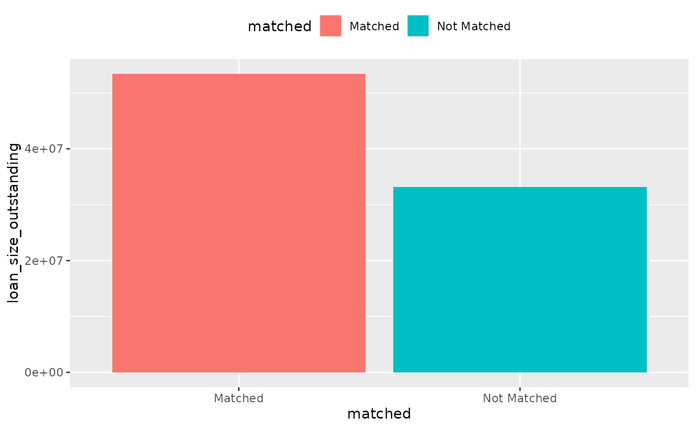
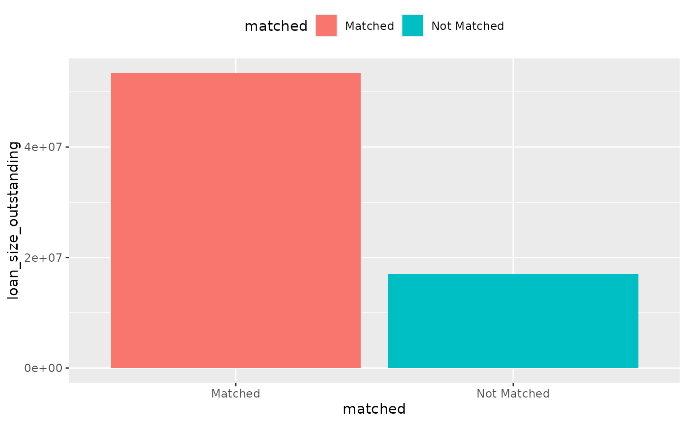
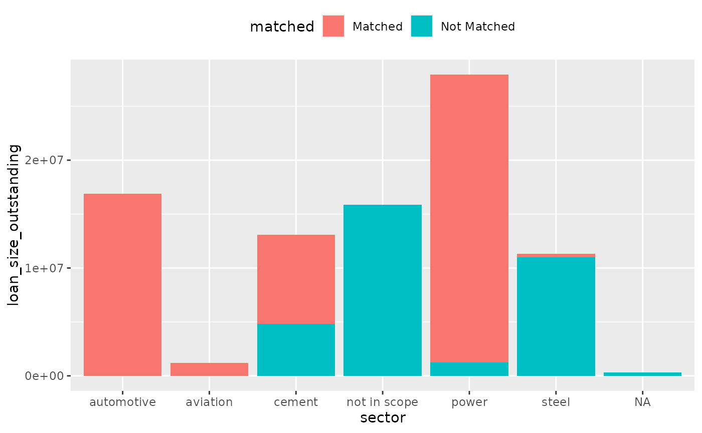
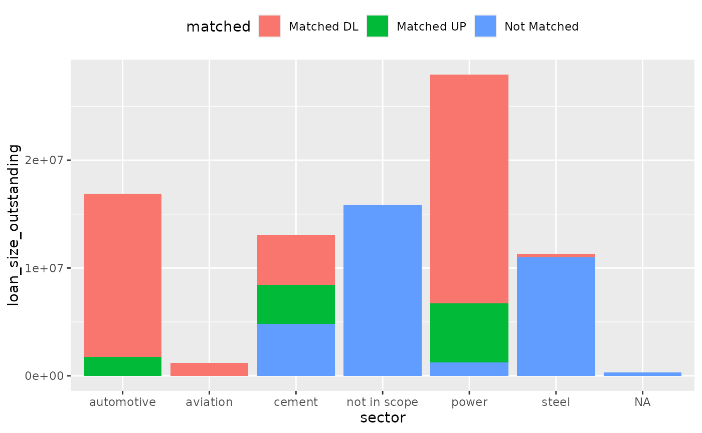
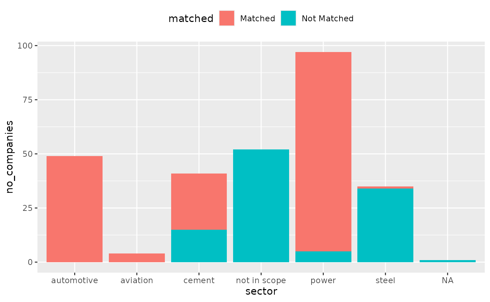
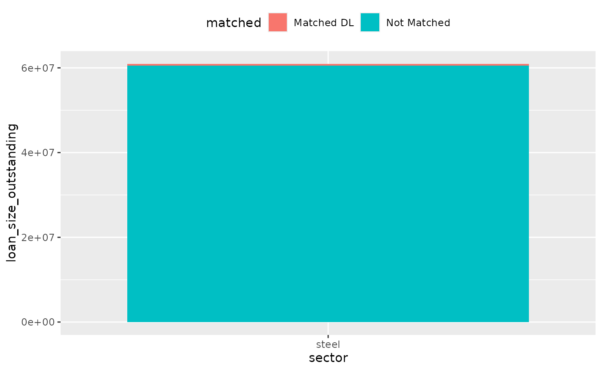
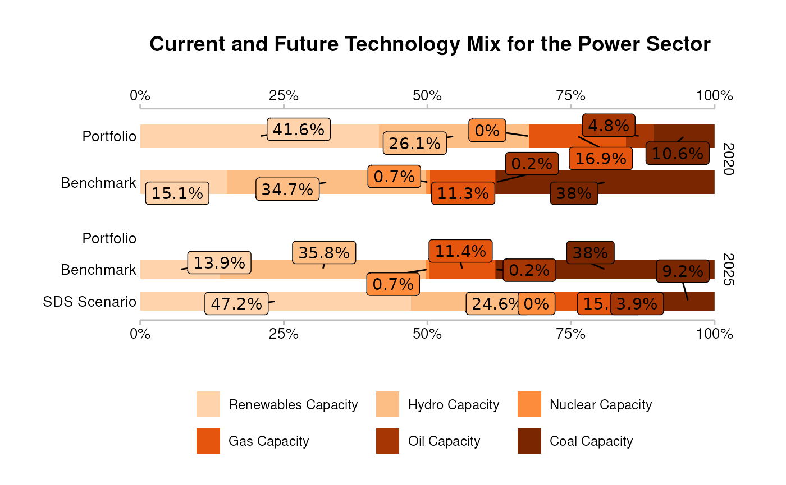
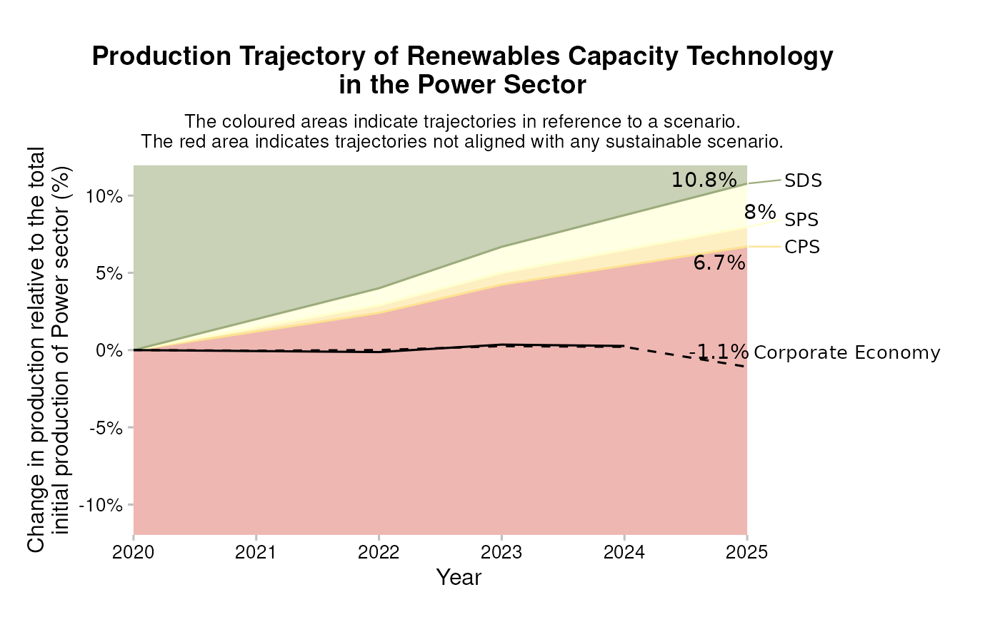

# Running the Analysis

## Running the Analysis

This section outlines the key steps for running the PACTA for Banks
analysis, beginning with a high-level overview followed by a detailed
breakdown of each step. Code snippets are provided to ensure a
straightforward implementation in your own R environment.

### Structure of the Workflow

If you have prepared or obtained all required input datasets as outlined
in [Preparatory
Steps](https://rmi-pacta.github.io/pacta.loanbook/dev/articles/cookbook_preparatory_steps.md),
you can then proceed with the PACTA for Banks analysis through the
following main steps:

1.  **Setup**: Load the necessary packages and import the data.
2.  **Matching process**: Match counterparties in the loan book to
    companies in the asset-based company data.
3.  **Calculate PACTA metrics**: Run the analysis to assess loan book
    alignment with transition scenario benchmarks.
4.  **Plot PACTA metrics**: Generate standard PACTA visualizations to
    support result interpretation.

Fig. 1: Structure of the Workflow

These steps are generally sequential, but achieving the best possible
match rate often requires multiple iterations. The matching process may
need to be refined and repeated to improve accuracy. The following
sections provide a detailed breakdown of each step.

### Setup

We use the [pacta.loanbook](https://rmi-pacta.github.io/pacta.loanbook/)
package for key functions and example datasets. Additionally, we
leverage [dplyr](https://dplyr.tidyverse.org),
[readxl](https://readxl.tidyverse.org), and
[readr](https://readr.tidyverse.org) for optional but convenient data
manipulation and import functions.

``` r
library(pacta.loanbook)
library(dplyr)
library(readxl)
library(readr)
```

### Import Data

We need two datasets to begin, as described in the [Preparatory
Steps](https://rmi-pacta.github.io/pacta.loanbook/dev/articles/cookbook_preparatory_steps.md)
chapter: a
[loanbook](https://rmi-pacta.github.io/pacta.loanbook/dev/articles/cookbook_preparatory_steps.html#raw-loan-book)
and an [asset-based company dataset
(abcd)](https://rmi-pacta.github.io/pacta.loanbook/dev/articles/cookbook_preparatory_steps.html#asset-based-company-data-abcd).
For more detail about the necessary structure of these datasets, see the
data dictionaries for
[loanbook](https://rmi-pacta.github.io/pacta.loanbook/dev/articles/data_loanbook.md)
and
[abcd](https://rmi-pacta.github.io/pacta.loanbook/dev/articles/data_abcd.md).

To simulate having these data files prepared, we will use the demo data
included in the
[pacta.loanbook](https://rmi-pacta.github.io/pacta.loanbook/) package to
create example XLS files using the
[writexl](https://ropensci.r-universe.dev/writexl) package.

``` r
library(writexl)

writexl::write_xlsx(
  x = loanbook_demo,
  path = file.path(tempdir(), "loanbook.xlsx")
)

writexl::write_xlsx(
  x = abcd_demo,
  path = file.path(tempdir(), "abcd.xlsx")
)
```

Typically, these data files are stored in XLS files on your computer. As
an example, they could be imported as in the code below using the
[readxl](https://readxl.tidyverse.org) package, however, if you use
custom data that does not strictly follow the format as defined in [the
previous
section](https://rmi-pacta.github.io/pacta.loanbook/dev/articles/cookbook_preparatory_steps.md),
you may need to adjust the import code and/or do some data manipulation
in R after importing.

``` r
loanbook <- readxl::read_excel(path = file.path(tempdir(), "loanbook.xlsx"))

loanbook
#> # A tibble: 283 × 13
#>    id_loan id_direct_loantaker name_direct_loantaker       id_ultimate_parent name_ultimate_parent                   loan_size_outstanding loan_size_outstanding_currency loan_size_credit_limit loan_size_credit_limit_currency sector_classification_system sector_classification_direct_loantaker lei_direct_loantaker isin_direct_loantaker
#>    <chr>   <chr>               <chr>                       <chr>              <chr>                                                  <dbl> <chr>                                           <dbl> <chr>                           <chr>                        <chr>                                  <chr>                <lgl>                
#>  1 L1      C294                Vitale Group                UP15               Scholz KGaA                                           225625 EUR                                          18968805 EUR                             NACE                         D35.11                                 NA                   NA                   
#>  2 L2      C293                Moen-Moen                   UP84               NA                                                    301721 EUR                                          19727961 EUR                             NACE                         D35.11                                 NA                   NA                   
#>  3 L3      C292                Rowe-Rowe                   UP288              Harvey, Harvey and Harvey                             410297 EUR                                          20811147 EUR                             NACE                         D35.11                                 801600ATB1D513IUFZ77 NA                   
#>  4 L4      C299                Fadel-Fadel                 UP54               NA                                                    233049 EUR                                          19042869 EUR                             NACE                         D35.11                                 NA                   NA                   
#>  5 L5      C305                Ring AG & Co. KGaA          UP104              Conti, Conti e Conti SPA                              406585 EUR                                          20774115 EUR                             NACE                         D35.11                                 NA                   NA                   
#>  6 L6      C304                Kassulke-Kassulke           UP83               Farrell, Farrell and Farrell                          185721 EUR                                          18570711 EUR                             NACE                         D35.11                                 108200TUBGG1DR0QR635 NA                   
#>  7 L7      C227                Morissette Group            UP134              Weller AG                                             184793 EUR                                          18561453 EUR                             NACE                         D35.11                                 NA                   NA                   
#>  8 L8      C303                Barone s.r.l.               UP163              Williamsonn PLC                                       291513 EUR                                          19626123 EUR                             NACE                         D35.11                                 NA                   NA                   
#>  9 L9      C301                Werner Werner AG & Co. KGaA UP138              Leone-Leone s.r.l.                                    407513 EUR                                          20783373 EUR                             NACE                         D35.11                                 NA                   NA                   
#> 10 L10     C302                De rosa s.r.l.              UP32               Benedetti, Benedetti e Benedetti Group                186649 EUR                                          18579969 EUR                             NACE                         D35.11                                 NA                   NA                   
#> # ℹ 273 more rows

abcd <- readxl::read_excel(path = file.path(tempdir(), "abcd.xlsx"))

abcd
#> # A tibble: 4,972 × 12
#>    company_id name_company                          lei                  sector technology          production_unit  year production emission_factor plant_location is_ultimate_owner emission_factor_unit             
#>    <chr>      <chr>                                 <chr>                <chr>  <chr>               <chr>           <dbl>      <dbl>           <dbl> <chr>          <lgl>             <chr>                            
#>  1 175        Giordano, Giordano e Giordano e figli 18500033XH6RG332SX89 power  hydrocap            MW               2020    121032.          NA     MY             TRUE              tonnes of CO2 per per hour per MW
#>  2 175        Giordano, Giordano e Giordano e figli 18500033XH6RG332SX89 power  hydrocap            MW               2021    119274.          NA     MY             TRUE              tonnes of CO2 per per hour per MW
#>  3 175        Giordano, Giordano e Giordano e figli 18500033XH6RG332SX89 power  hydrocap            MW               2022    117515.          NA     MY             TRUE              tonnes of CO2 per per hour per MW
#>  4 175        Giordano, Giordano e Giordano e figli 18500033XH6RG332SX89 power  hydrocap            MW               2023    115757.          NA     MY             TRUE              tonnes of CO2 per per hour per MW
#>  5 175        Giordano, Giordano e Giordano e figli 18500033XH6RG332SX89 power  hydrocap            MW               2024    113999.          NA     MY             TRUE              tonnes of CO2 per per hour per MW
#>  6 175        Giordano, Giordano e Giordano e figli 18500033XH6RG332SX89 power  hydrocap            MW               2025    112240.          NA     MY             TRUE              tonnes of CO2 per per hour per MW
#>  7 526        Vitali, Vitali e Vitali s.r.l.        887100CAVZ6Y3KYT3Q90 cement integrated facility tonnes per year  2020   6327858.           0.723 CI             TRUE              tonnes of CO2 per tonne of cement
#>  8 526        Vitali, Vitali e Vitali s.r.l.        887100CAVZ6Y3KYT3Q90 cement integrated facility tonnes per year  2021   6569983.           0.735 CI             TRUE              tonnes of CO2 per tonne of cement
#>  9 526        Vitali, Vitali e Vitali s.r.l.        887100CAVZ6Y3KYT3Q90 cement integrated facility tonnes per year  2022   6812108.           0.746 CI             TRUE              tonnes of CO2 per tonne of cement
#> 10 526        Vitali, Vitali e Vitali s.r.l.        887100CAVZ6Y3KYT3Q90 cement integrated facility tonnes per year  2023   7054232.           0.758 CI             TRUE              tonnes of CO2 per tonne of cement
#> # ℹ 4,962 more rows
```

### Matching Process

The next step after loading all required input files is to run the
matching process, where you will match loans from the loanbook data with
production data from the ABCD dataset

The matching process is divided into three main steps:

1.  Apply Matching Algorithm – Calculate match precision scores between
    the loan book and ABCD datasets.
2.  Validate Matches – Manually review matches, selecting the correct
    company when multiple exceed the threshold score.
3.  Prioritize Matches – Pick validated matches by priority level.

The following sections provide a detailed breakdown of each step.

#### Apply Matching Algorithm – Calculate match precision scores between the loan book and ABCD datasets

[`match_name()`](https://rmi-pacta.github.io/pacta.loanbook/dev/reference/match_name.md)
scores the match between names in a loanbook dataset and names in an
asset-based company dataset. The names come from the columns
`name_direct_loantaker` and `name_ultimate_parent` of the loanbook
dataset, and from the column `name_company` of the asset-based company
dataset. In the loan book data set, it is possible to optionally add any
number of `name_intermediate_parent_*` columns, where `*` indicates the
level up the corporate tree from `direct_loantaker`.

The raw names are internally transformed applying best-practices
commonly used in name matching algorithms, such as:

- Remove special characters
- Replace language specific characters
- Abbreviate certain names to reduce their importance in the matching
- Remove corporate suffixes when necessary
- Spell out numbers to increase their importance

The similarity is then scored between the internally-transformed names
of the loanbook against the names in the abcd. For more information on
the scoring algorithm used, see
[`stringdist::stringsim()`](https://rdrr.io/pkg/stringdist/man/stringsim.html).

The basic usage of
[`match_name()`](https://rmi-pacta.github.io/pacta.loanbook/dev/reference/match_name.md)
is as follows:

``` r
matched <- match_name(loanbook, abcd)

matched
#> # A tibble: 326 × 22
#>    id_loan id_direct_loantaker name_direct_loantaker       id_ultimate_parent name_ultimate_parent         loan_size_outstanding loan_size_outstanding_currency loan_size_credit_limit loan_size_credit_limit_currency sector_classification_system sector_classification_direct_loantaker lei_direct_loantaker isin_direct_loantaker id_2dii level   sector sector_abcd name  name_abcd score source borderline
#>    <chr>   <chr>               <chr>                       <chr>              <chr>                                        <dbl> <chr>                                           <dbl> <chr>                           <chr>                        <chr>                                  <chr>                <lgl>                 <chr>   <chr>   <chr>  <chr>       <chr> <chr>     <dbl> <chr>  <lgl>     
#>  1 L1      C294                Vitale Group                UP15               Scholz KGaA                                 225625 EUR                                          18968805 EUR                             NACE                         D35.11                                 NA                   NA                    UP190   ultima… power  power       Scho… Scholz K… 1     loanb… FALSE     
#>  2 L3      C292                Rowe-Rowe                   UP288              Harvey, Harvey and Harvey                   410297 EUR                                          20811147 EUR                             NACE                         D35.11                                 801600ATB1D513IUFZ77 NA                    UP101   ultima… power  power       Harv… Harvey, … 1     loanb… FALSE     
#>  3 L5      C305                Ring AG & Co. KGaA          UP104              Conti, Conti e Conti SPA                    406585 EUR                                          20774115 EUR                             NACE                         D35.11                                 NA                   NA                    UP39    ultima… power  power       Cont… Conti, C… 1     loanb… FALSE     
#>  4 L6      C304                Kassulke-Kassulke           UP83               Farrell, Farrell and Farrell                185721 EUR                                          18570711 EUR                             NACE                         D35.11                                 108200TUBGG1DR0QR635 NA                    DL129   direct… power  power       Kass… Kassulke… 1     loanb… FALSE     
#>  5 L6      C304                Kassulke-Kassulke           UP83               Farrell, Farrell and Farrell                185721 EUR                                          18570711 EUR                             NACE                         D35.11                                 108200TUBGG1DR0QR635 NA                    UP63    ultima… power  power       Farr… Farrell,… 1     loanb… FALSE     
#>  6 L7      C227                Morissette Group            UP134              Weller AG                                   184793 EUR                                          18561453 EUR                             NACE                         D35.11                                 NA                   NA                    DL179   direct… power  power       Mori… Moretti … 0.911 loanb… FALSE     
#>  7 L7      C227                Morissette Group            UP134              Weller AG                                   184793 EUR                                          18561453 EUR                             NACE                         D35.11                                 NA                   NA                    UP224   ultima… power  power       Well… Weller AG 1     loanb… FALSE     
#>  8 L8      C303                Barone s.r.l.               UP163              Williamsonn PLC                             291513 EUR                                          19626123 EUR                             NACE                         D35.11                                 NA                   NA                    UP228   ultima… power  power       Will… Williams… 0.987 loanb… FALSE     
#>  9 L9      C301                Werner Werner AG & Co. KGaA UP138              Leone-Leone s.r.l.                          407513 EUR                                          20783373 EUR                             NACE                         D35.11                                 NA                   NA                    DL274   direct… power  power       Wern… Wende We… 0.844 loanb… FALSE     
#> 10 L9      C301                Werner Werner AG & Co. KGaA UP138              Leone-Leone s.r.l.                          407513 EUR                                          20783373 EUR                             NACE                         D35.11                                 NA                   NA                    UP132   ultima… power  power       Leon… Leone-Le… 1     loanb… FALSE     
#> # ℹ 316 more rows
```

[`match_name()`](https://rmi-pacta.github.io/pacta.loanbook/dev/reference/match_name.md)
defaults to scoring matches between name strings that belong to the same
sector. This implies that a potential match will only be shown if the
names in the loanbook and the ABCD are sufficiently similar AND the loan
is classified in the same sector as the company activity in the ABCD
Using `by_sector = FALSE` removes this limitation – increasing
computation time, and the number of potentially incorrect matches to
manually validate. In most cases, it is recommended to keep
`by_sector = TRUE`. However, lifting the restriction can be helpful in
cases where the sector classification in the loanbook is not reliable or
no sector classification is available at all. Below you can see that the
removal of the restriction increases the number of potential matches.

The
[`match_name()`](https://rmi-pacta.github.io/pacta.loanbook/dev/reference/match_name.md)
function, by default, scores matches between name strings within the
same sector. This means a potential match is shown only if: - The names
in the loan book and ABCD dataset are sufficiently similar. - The loan
is classified in the same sector as the company activity in the ABCD
dataset.

Setting `by_sector = FALSE` removes this restriction, which: - Increases
computation time. - Increases the number of potential (but possibly
incorrect) matches requiring manual validation.

In most cases, keeping `by_sector = TRUE` is recommended. However,
disabling the sector restriction can be useful when sector
classifications in the loan book are unreliable or missing. Below, you
can see how removing the restriction increases the number of potential
matches.

``` r
match_name(loanbook, abcd, by_sector = FALSE) %>% nrow()
#> [1] 656

# Compare to
match_name(loanbook, abcd, by_sector = TRUE) %>% nrow()
#> [1] 326
```

The `min_score` argument sets a minimum threshold score for matching
precision. This helps by: - Filtering out imprecise matches by setting a
higher threshold. - Adding more potential matches if the default
suggestions do not provide enough coverage.

The default value is 0.8, but you can adjust it between 0 and 1. A
higher score means stricter matching, resulting in fewer potential
matches.

The example below sets the threshold to 0.9:

``` r
match_name(loanbook, abcd, min_score = 0.9) %>%
  pull(score) %>%
  range()
#> [1] 0.9007692 1.0000000
```

#### Validate Matches – Manually review matches, selecting the correct company when multiple exceed the threshold score

After calculating initial match scores, you must manually review the
suggested matches to decide which to keep or remove. This step is
critical for ensuring a high quality match result, especially in
text-based matching, where similar company names may not actually refer
to the same entity.

Manual validation helps to:

- Prevent incorrect matches from affecting the analysis.
- Ensure accuracy in linking loan book data to the ABCD dataset.
- Improve overall match precision, especially when iterating to enhance
  coverage.

Since this step is not automated, it requires effort, often making it
the most time-consuming part of the process.

To begin, save the output of match_name() to a CSV file for review. For
example, using [readr](https://readr.tidyverse.org):

``` r
readr::write_csv(x = matched, file = file.path(tempdir(), "matched.csv"))
```

After exporting the match results, you must manually review, edit, and
save the data: - **Open the file** – Load `matched.csv` in a spreadsheet
editor (Excel, Google Sheets, etc.). - **Compare matches** – Verify if
the `name` (loan book) and `name_abcd` (ABCD) correspond to the same
entity. Use additional details (sector, company structure, internal
data) to improve accuracy. - **Edit the data**: - If the match is valid,
set the `score` value to `1`. - If the match is incorrect or uncertain,
leave the `score` as-is or set it to a value other than `1`. - **Save
the edited file**: as `valid_matches.csv`.

Once validated, re-import the edited file into R, for example, using
[readr](https://readr.tidyverse.org):

``` r
valid_matches <- readr::read_csv(file = file.path(tempdir(), "valid_matches.csv"), show_col_types = FALSE)
```

You can find more detailed information about the matching process under
the header “PACTA for Banks Training Webinar 2” in the [training
materials section of the PACTA for Banks
website](https://pacta.rmi.org/pacta-for-banks-2020/training-materials/)
and in the [corresponding slide
deck](https://pacta.rmi.org/wp-content/uploads/2020/12/PACTA-for-Banks-Training-Webinar-2-Matching-a-loan-book-to-physical-assets-in-the-real-economy-.pdf).

#### Prioritize Matches – Pick validated matches by priority level

The validated dataset may have multiple matches per loan. Consider the
case where a loan is given to “Acme Power USA”, a subsidiary of “Acme
Power Co.”. There may be both “Acme Power USA” and “Acme Power Co.” in
the `abcd`, and so there could be two valid matches for this loan. To
get the best match only, use
[`prioritize()`](https://rmi-pacta.github.io/pacta.loanbook/dev/reference/prioritize.md)
– it picks rows where `score` is 1 and `level` per loan is of highest
`priority`:

``` r
some_interesting_columns <- c("id_loan", "level", "score")

prioritized_matches <-
  valid_matches %>%
  prioritize()

prioritized_matches %>% select(all_of(some_interesting_columns))
#> # A tibble: 177 × 3
#>    id_loan level            score
#>    <chr>   <chr>            <dbl>
#>  1 L6      direct_loantaker     1
#>  2 L13     direct_loantaker     1
#>  3 L20     direct_loantaker     1
#>  4 L21     direct_loantaker     1
#>  5 L22     direct_loantaker     1
#>  6 L24     direct_loantaker     1
#>  7 L25     direct_loantaker     1
#>  8 L26     direct_loantaker     1
#>  9 L27     direct_loantaker     1
#> 10 L28     direct_loantaker     1
#> # ℹ 167 more rows
```

By default, highest priority refers to the most granular match
(`direct_loantaker`). The default priority is set internally via
[`prioritize_level()`](https://rmi-pacta.github.io/pacta.loanbook/dev/reference/prioritize_level.md).

``` r
prioritize_level(valid_matches)
#> [1] "direct_loantaker" "ultimate_parent"
```

You may use a different prioritization stratgey by passing a function to
the `priority` argument of
[`prioritize()`](https://rmi-pacta.github.io/pacta.loanbook/dev/reference/prioritize.md).

#### A Note on Sector Classifications and the `borderline` Flag

##### Sector Classifications

Matches are preferred when the sector from the `loanbook` matches the
sector from the `abcd`. The `loanbook` sector is determined internally
by mapping the sector classification code from the loan book to a PACTA
sector, using the `sector_classification_system` and
`sector_classification_direct_loantaker` columns. Currently, the
following options are supported for `sector_classification_system`,
specified in `sector_classifications`:

> GICS, ISIC, NACE, NAICS, PSIC, SIC

##### The `borderline` flag

An issue arises when, for example, a company is classified in the “power
transmission” sector. In a perfect world, these companies would produce
no electricity, and we would not try to match them. In practice,
however, we find there is often overlap, as companies may have
integrated business models that span multiple steps of the supply chain
or sector classification systems do not break down every code clearly
enough to map it to PACTA sectors unambiguously. For this reason, we
introduced the `borderline` flag.

In the example below, we see two classification codes coming from the
NACE classification standard:

``` r
nace_classification %>% 
  filter(code %in% c("D35.11", "D35.14", "D35.1"))
#> # A tibble: 3 × 6
#>   original_code description                      code  sector borderline version
#>   <chr>         <chr>                            <chr> <chr>  <lgl>      <chr>  
#> 1 35.1          35.1 Electric power generation,… D35.1 power  TRUE       2.1    
#> 2 35.11         35.11 Production of electricity… D35.… power  FALSE      2.1    
#> 3 35.14         35.14 Distribution of electrici… D35.… power  TRUE       2.1
```

Notice that the code D35.11 corresponds to power generation. This is an
identical match to `power` sector in PACTA, and thus the `borderline`
flag is set to `FALSE`. In contrast, code D35.14 corresponds to the
distribution of electricity. In a perfect world, we would set this code
to `not in scope`, however there is still a chance that these companies
produce electricity. For this reason, we have mapped it to `power` with
`borderline = TRUE`. Finally, code D35.1 corresponds to the wider
electricity sector, covering “Electric power generation, transmission
and distribution”. This is a case where the granularity is insufficient
to unambiguously match the code to the `power` sector as defined in
PACTA, and thus the `borderline` flag is set to `TRUE`.

In practice, if a company has a sector code with `borderline` is `TRUE`
and *is* matched, then consider the company in scope. If it has a
`borderline` value `TRUE` and *is not* matched, then consider it out of
scope.

#### Optional: Prepare own sector classification mapper

If you can obtain sector codes in any one of those classification
systems for your loan book, it is strongly recommended using them. If
you do not have your loans mapped to any of these systems, you can
either run the matching without a sector classification (see above), or
you can use a custom sector classification system.

If you want to use your own custom sector classification system, you
will need to create a file that follows the same structure as the sector
classification files in `sector_classifications`, that is, the file
needs to contain the following columns (of the following types):

- `sector`: \<character\>
- `borderline`: \<logical\>
- `code`: \<character\>
- `code_system`: \<character\>

Please notice that when manually preparing a custom sector
classification file, you need to decide for every code of your mapping
system which PACTA sector the code maps to. This requires the system to
be relatively granular to capture the nuances of the supply chains of
the companies in your loan book. As discussed above, any sector code
that is not unambiguously in scope or out of scope for a given PACTA
sector should be marked `TRUE` in the `borderline` column. Any sector
code that is clearly not in scope should be marked `FALSE` and receive
the sector value `not in scope`. Any sector code that is clearly in
scope should be marked `FALSE` for `borderline` and receive the PACTA
sector value that it maps to in the `sector` column.

For a code example how to implement your own sector classification
system, see the [sector classification example in the match_name
reference](https://rmi-pacta.github.io/pacta.loanbook/reference/match_name.html#ref-examples).

#### Calculate the Match Success Rate

[pacta.loanbook](https://rmi-pacta.github.io/pacta.loanbook/) allows you
to match loans from your loanbook to the companies in an asset-based
company dataset. However, not all loans will have a match – some
companies may be missing from the ABCD dataset, or they may operate
outside the PACTA focus sectors (power, cement, oil and gas, aviation,
coal, automotive, steel, and hdv).

To assess how much of your loan book is successfully matched, you can
calculate matching coverage in two ways:

1.  By dollar value: Measure the portion of your loan book covered,
    using one of the `loan_size_*` columns.

2.  By company count: Count the number of companies matched.

To visualize matching coverage, first load the
[ggplot2](https://ggplot2.tidyverse.org) package:

``` r
library(ggplot2)
```

We will use the example datasets created in the previous section. To
illustrate the point, we create a `loanbook` dataset with two mismatched
loans:

``` r
loanbook <- loanbook %>% 
  mutate(
    name_ultimate_parent = 
      ifelse(id_loan == "L1", "unmatched company name", name_ultimate_parent),
    sector_classification_direct_loantaker = 
      ifelse(id_loan == "L2", "99", sector_classification_direct_loantaker)
  )
```

We will then run the matching algorithm on this loanbook:

``` r
matched <- loanbook %>% 
    match_name(abcd) %>% 
    prioritize()
#> Warning: Some values in `sector_classification_direct_loantaker` are unknown: "99"
#> ℹ The unknown values do not appear in the specified sector classification
#>   system.
```

The `matched` dataset contains *only* successfully matched loans. To
determine coverage, we need to refer back to the original loanbook
dataset and classify each loan according to the PACTA sectors using the
`sector_classification_direct_loantaker` column.

To achieve this, we merge loanbook with the `sector_classifications`
dataset, which includes all sector classification standards used by
PACTA. However, there are two technical caveats to consider:

1.  Column name differences: The datasets use different column names for
    sector classifications. We use
    [`dplyr::left_join()`](https://dplyr.tidyverse.org/reference/mutate-joins.html)
    with the `by` argument to merge:

- `sector_classification_system` and
  `sector_classification_direct_loantaker` (from `loanbook`)
- `code_system` and `code` (from `sector_classifications`)

2.  Data type mismatch: The sector classification codes have different
    data types in the two datasets. To prevent errors in
    [`dplyr::left_join()`](https://dplyr.tidyverse.org/reference/mutate-joins.html):

- We convert `sector_classification_direct_loantaker` to match the type
  of `code` before merging.
- After merging, we restore its original type.

``` r
merge_by <- c(
    sector_classification_system = "code_system",
    sector_classification_direct_loantaker = "code"
  )

loanbook_with_sectors <- loanbook %>% 
  left_join(sector_classifications, by = merge_by) %>% 
  mutate(sector_classification_direct_loantaker = as.character(sector_classification_direct_loantaker))
```

To generate the `coverage` dataset, we merge these two datasets
together:

``` r
coverage <- left_join(loanbook_with_sectors, matched) %>% 
  mutate(
    loan_size_outstanding = as.numeric(loan_size_outstanding),
    loan_size_credit_limit = as.numeric(loan_size_credit_limit),
    matched = case_when(
      score == 1   ~ "Matched", 
      is.na(score) ~ "Not Matched",
      TRUE         ~ "Not Matched"
    ),
    sector = case_when(
      borderline == TRUE & matched == "Not Matched" ~ "not in scope",
      TRUE ~ sector
    )
  )
#> Joining with `by = join_by(id_loan, id_direct_loantaker, name_direct_loantaker,
#> id_ultimate_parent, name_ultimate_parent, loan_size_outstanding,
#> loan_size_outstanding_currency, loan_size_credit_limit,
#> loan_size_credit_limit_currency, sector_classification_system,
#> sector_classification_direct_loantaker, lei_direct_loantaker,
#> isin_direct_loantaker, sector, borderline)`
```

##### 1. Calculate loanbook coverage by dollar value

Using the `coverage` dataset, we can measure total loan book coverage
based on dollar value. To facilitate this, we define two helper
functions:

1.  A function to calculate coverage by dollar value.
2.  A plotting function to visualize coverage.

``` r
dollar_value <- function(data, ...) {
  data %>% 
    summarize(loan_size_outstanding = sum(loan_size_outstanding), .by = c(matched, ...))
}

plot_coverage <- function(data, x, y) {
  ggplot(data) + 
    geom_col(aes({{x}}, {{y}}, fill = matched)) +
    # Use more horizontal space -- avoids overlap on x axis text
    theme(legend.position = "top")
}
```

Let’s first explore all loans.

``` r
coverage %>% 
  dollar_value() %>% 
  plot_coverage(matched, loan_size_outstanding)
```



To calculate the total, in-scope, loanbook coverage:

``` r
coverage %>% 
  filter(sector != "not in scope") %>% 
  dollar_value() %>% 
  plot_coverage(matched, loan_size_outstanding)
```



You may break-down the plot by sector:

``` r
coverage %>% 
  dollar_value(sector) %>% 
  plot_coverage(sector, loan_size_outstanding)
```



Or even further, by matching level:

``` r
coverage %>% 
  mutate(matched = case_when(
    matched == "Matched" & level == "direct_loantaker"      ~ "Matched DL",
    matched == "Matched" & level == "intermediate_parent_1" ~ "Matched IP1",
    matched == "Matched" & level == "ultimate_parent"       ~ "Matched UP",
    matched == "Not Matched"                                ~ "Not Matched",
    TRUE                                                    ~ "Catch unknown"
  )) %>% 
  dollar_value(sector) %>% 
  plot_coverage(sector, loan_size_outstanding)
```



##### 2. Count the number of companies matched

Another useful metric is the number of companies in your loan book that
were successfully matched. The most relevant level for this analysis is
likely the `direct_loantaker` level.

``` r
companies_matched <- coverage %>% 
  summarize(no_companies = n_distinct(name_direct_loantaker), .by = c(sector, matched))

companies_matched %>% 
  plot_coverage(sector, no_companies)
```



#### Optional: Handling misclassified loans

A misclassified loan occurs when a counterparty is incorrectly
identified as belonging to a PACTA sector based on the sector
classification in the loan book.

Why does misclassification matter? - It artificially lowers match
success rates by expecting matches that do not exist in the ABCD
dataset. - Iterating the matching process will not help—if a company
does not operate in an in-scope sector, no adjustments will create a
valid match. - A reliable match success rate requires an accurate
denominator, meaning only loans truly within an in-scope sector should
be included.

Misclassification is typically identified manually by reviewing
unmatched counterparties to determine if they should be in scope. Since
this process can be time-consuming, it is best to prioritize unmatched
loans with the largest credit amounts, as they have the greatest impact
on the match success rate.

Since misclassified loans cannot be matched, leaving them in the dataset
skews results. While correction is not mandatory, adjusting large
misclassified loans is strongly recommended for more accurate analysis.

##### Options for Handling Misclassified Loans

Once misclassified loans have been identified, there are two options:

1.  Correct the classification in the loanbook:

- Update the raw loanbook to reflect the correct sector.
- Re-run the matching process to ensure the loan is matched
  appropriately
- Keep documentation of changes for replicability

2.  Adjust match success rate calculation:

- If modifying the raw loanbook is not possible, exclude misclassified
  loans from the success rate calculation.
- Create a `loans_to_remove.csv` file containing a single column,
  `id_loan`, listing the misclassified loans.
- Remove these loans from the match success calculation to avoid
  misleading results.

The first option is generally preferred, as it ensures loans are
assigned to the correct sector.

Once the list of misclassified loans is identified, there are two broad
options to appropriately these cases.

##### Example

Suppose a loan with ID L255 is falsely classified as a steel company but
actually produces steel-based products, making it part of the downstream
value chain rather than primary steel production. Since it cannot be
matched to ABCD, but the sector classification cannot be changed, we
handle it by creating a CSV file with its ID.

This correction process can be done programmatically or manually,
ensuring more accurate match success rate reporting.

``` r
readr::write_csv(
  x = tibble(id_loan = "L255"),
  file = file.path(tempdir(), "loans_to_remove.csv")
)
```

The `loans_to_remove.csv` file should have just one column, `id_loan`,
and therefore be structured as follows:

- `id_loan`: \<character\>

We then read in the file and remove the misclassified loan from the
match success rate calculation. We compare the coverage before and after
the removal of the misclassified loan to see the impact of the
correction. For demonstration purposes, we artificially increase the
loan_size_outstanding of the affected counterparty while focusing on the
steel sector only, to see the clear impact.

``` r
coverage_compare <- coverage %>% 
  mutate(
    loan_size_outstanding = ifelse(id_loan == "L255", 50000000, loan_size_outstanding)
  ) %>% 
  filter(sector == "steel")

coverage_compare %>%
  mutate(matched = case_when(
    matched == "Matched" & level == "direct_loantaker"      ~ "Matched DL",
    matched == "Matched" & level == "intermediate_parent_1" ~ "Matched IP1",
    matched == "Matched" & level == "ultimate_parent"       ~ "Matched UP",
    matched == "Not Matched"                                ~ "Not Matched",
    TRUE                                                    ~ "Catch unknown"
  )) %>% 
  dollar_value(sector) %>% 
  plot_coverage(sector, loan_size_outstanding)
```



``` r

loans_to_remove <- readr::read_csv(file.path(tempdir(), "loans_to_remove.csv"))

coverage_corrected <- coverage_compare %>% 
  anti_join(loans_to_remove, by = "id_loan")

coverage_corrected %>% 
  mutate(matched = case_when(
    matched == "Matched" & level == "direct_loantaker"      ~ "Matched DL",
    matched == "Matched" & level == "intermediate_parent_1" ~ "Matched IP1",
    matched == "Matched" & level == "ultimate_parent"       ~ "Matched UP",
    matched == "Not Matched"                                ~ "Not Matched",
    TRUE                                                    ~ "Catch unknown"
  )) %>% 
  dollar_value(sector) %>% 
  plot_coverage(sector, loan_size_outstanding)
```


### Calculate PACTA alignment metrics

PACTA alignment metrics can be calculated using two approaches: the
[Market Share
Approach](https://rmi-pacta.github.io/pacta.loanbook/dev/articles/cookbook_metrics.html#market-share-approach)
and the [Sectoral Decarbonization
Approach](https://rmi-pacta.github.io/pacta.loanbook/dev/articles/cookbook_metrics.html#sectoral-decarbonization-approach).
If a sector has a technology-level scenario pathway you can use the
Market Share Approach whereas sector-level scenario pathways will use
the Sectoral Decarbonization Approach. If you are using the scenarios
prepared by RMI, you will have the following pairing of approaches,
sectors and technologies:

Sector-Technology Pairs for PACTA Alignment Metrics

Sector and Technology Pairings for Market Share and Sectoral
Decarbonization Approaches

#### Market Share Approach

The [Market Share
Approach](https://rmi-pacta.github.io/pacta.loanbook/dev/articles/cookbook_metrics.html#market-share-approach)
sets scenario targets based on the production of a technology within a
sector. For example, it can define targets for electric vehicle
production in the automotive sector. This approach is recommended for
sectors with detailed technology roadmaps.

Targets can be set at the portfolio level:

``` r
# Use these datasets to practice but eventually you should use your own data.
scenario <- scenario_demo_2020
regions <- region_isos_demo

market_share_targets_portfolio <-
  target_market_share(
    data = prioritized_matches,
    abcd = abcd,
    scenario = scenario,
    region_isos = regions
  )

market_share_targets_portfolio
#> # A tibble: 1,210 × 10
#>    sector     technology  year region scenario_source metric     production technology_share scope  percentage_of_initial_production_by_scope
#>    <chr>      <chr>      <dbl> <chr>  <chr>           <chr>           <dbl>            <dbl> <chr>                                      <dbl>
#>  1 automotive electric    2020 global demo_2020       projected     145649.            0.165 sector                                  0       
#>  2 automotive electric    2020 global demo_2020       target_cps    145649.            0.165 sector                                  0       
#>  3 automotive electric    2020 global demo_2020       target_sds    145649.            0.165 sector                                  0       
#>  4 automotive electric    2020 global demo_2020       target_sps    145649.            0.165 sector                                  0       
#>  5 automotive electric    2021 global demo_2020       projected     147480.            0.165 sector                                  0.000739
#>  6 automotive electric    2021 global demo_2020       target_cps    148314.            0.163 sector                                  0.00108 
#>  7 automotive electric    2021 global demo_2020       target_sds    161823.            0.167 sector                                  0.00653 
#>  8 automotive electric    2021 global demo_2020       target_sps    149035.            0.163 sector                                  0.00137 
#>  9 automotive electric    2022 global demo_2020       projected     149310.            0.165 sector                                  0.00148 
#> 10 automotive electric    2022 global demo_2020       target_cps    150923.            0.161 sector                                  0.00213 
#> # ℹ 1,200 more rows
```

or at the company level:

``` r
market_share_targets_company <-
  target_market_share(
    data = prioritized_matches,
    abcd = abcd,
    scenario = scenario,
    region_isos = regions,
    by_company = TRUE, # Output results at company-level
    weight_production = FALSE
  )

market_share_targets_company
#> # A tibble: 37,349 × 11
#>    sector     technology  year region scenario_source name_abcd                      metric     production technology_share scope  percentage_of_initial_production_by_scope
#>    <chr>      <chr>      <dbl> <chr>  <chr>           <chr>                          <chr>           <dbl>            <dbl> <chr>                                      <dbl>
#>  1 automotive electric    2020 global demo_2020       Bahr                           projected           0                0 sector                                         0
#>  2 automotive electric    2020 global demo_2020       Bahr                           target_cps          0                0 sector                                         0
#>  3 automotive electric    2020 global demo_2020       Bahr                           target_sds          0                0 sector                                         0
#>  4 automotive electric    2020 global demo_2020       Bahr                           target_sps          0                0 sector                                         0
#>  5 automotive electric    2020 global demo_2020       Beier, Beier and Beier         projected           0                0 sector                                         0
#>  6 automotive electric    2020 global demo_2020       Beier, Beier and Beier         target_cps          0                0 sector                                         0
#>  7 automotive electric    2020 global demo_2020       Beier, Beier and Beier         target_sds          0                0 sector                                         0
#>  8 automotive electric    2020 global demo_2020       Beier, Beier and Beier         target_sps          0                0 sector                                         0
#>  9 automotive electric    2020 global demo_2020       Bellini, Bellini e Bellini SPA projected           0                0 sector                                         0
#> 10 automotive electric    2020 global demo_2020       Bellini, Bellini e Bellini SPA target_cps          0                0 sector                                         0
#> # ℹ 37,339 more rows
```

These results can be saved/written to a CSV file for potential input to
other models and software, for example:

``` r
readr::write_csv(x = market_share_targets_portfolio, file = file.path(tempdir(), "market_share_targets_portfolio.csv"))
readr::write_csv(x = market_share_targets_company, file = file.path(tempdir(), "market_share_targets_company.csv"))
```

Remember to replace [`tempdir()`](https://rdrr.io/r/base/tempfile.html)
with the path to the directory that you wish to save your files in.

#### Sectoral Decarbonization Approach

The [Sectoral Decarbonization
Approach](https://rmi-pacta.github.io/pacta.loanbook/dev/articles/cookbook_metrics.html#sectoral-decarbonization-approach)
sets scenario targets based on a sector’s emission factor. For example,
it can define targets for the average emission factor in the cement
sector. This approach is recommended for sectors without detailed
technology roadmaps.

``` r
# Use this dataset to practice but eventually you should use your own data.
co2 <- co2_intensity_scenario_demo

sda_targets_portfolio <-
  target_sda(
    data = prioritized_matches,
    abcd = abcd,
    co2_intensity_scenario = co2,
    region_isos = regions
  ) %>% 
  filter(sector == "cement", year >= 2020)
#> Warning: Removing rows in abcd where `emission_factor` is NA

sda_targets_portfolio
#> # A tibble: 110 × 6
#>    sector  year region             scenario_source emission_factor_metric emission_factor_value
#>    <chr>  <dbl> <chr>              <chr>           <chr>                                  <dbl>
#>  1 cement  2020 advanced economies demo_2020       projected                             0.0230
#>  2 cement  2020 developing asia    demo_2020       projected                             0.0595
#>  3 cement  2020 global             demo_2020       projected                             0.664 
#>  4 cement  2021 advanced economies demo_2020       projected                             0.0232
#>  5 cement  2021 developing asia    demo_2020       projected                             0.0594
#>  6 cement  2021 global             demo_2020       projected                             0.665 
#>  7 cement  2022 advanced economies demo_2020       projected                             0.0233
#>  8 cement  2022 developing asia    demo_2020       projected                             0.0592
#>  9 cement  2022 global             demo_2020       projected                             0.666 
#> 10 cement  2023 advanced economies demo_2020       projected                             0.0235
#> # ℹ 100 more rows
```

or at the company level:

``` r
sda_targets_company <-
  target_sda(
    data = prioritized_matches,
    abcd = abcd,
    co2_intensity_scenario = co2,
    region_isos = regions,
    by_company = TRUE # Output results at company-level
  )
#> Warning: Removing rows in abcd where `emission_factor` is NA

sda_targets_company
#> # A tibble: 966 × 7
#>    sector  year region             scenario_source name_abcd                          emission_factor_metric emission_factor_value
#>    <chr>  <dbl> <chr>              <chr>           <chr>                              <chr>                                  <dbl>
#>  1 cement  2020 advanced economies demo_2020       Milani, Milani e Milani SPA        projected                              0.714
#>  2 cement  2020 developing asia    demo_2020       Heidrich GmbH                      projected                              0.675
#>  3 cement  2020 developing asia    demo_2020       Hovel Hovel GmbH & Co. KGaA        projected                              0.622
#>  4 cement  2020 global             demo_2020       Battaglia-Battaglia Group          projected                              0.626
#>  5 cement  2020 global             demo_2020       Bergstrom, Bergstrom and Bergstrom projected                              0.607
#>  6 cement  2020 global             demo_2020       Carsten GmbH & Co. KG              projected                              0.625
#>  7 cement  2020 global             demo_2020       Crist-Crist                        projected                              0.655
#>  8 cement  2020 global             demo_2020       Durgan-Durgan                      projected                              0.702
#>  9 cement  2020 global             demo_2020       Eberhardt Eberhardt GmbH           projected                              0.685
#> 10 cement  2020 global             demo_2020       Geissler Geissler AG & Co. KGaA    projected                              0.637
#> # ℹ 956 more rows
```

These results can be saved/written to a CSV file for potential input to
other models and software, for example:

``` r
readr::write_csv(x = sda_targets_portfolio, file = file.path(tempdir(), "sda_targets_portfolio.csv"))
readr::write_csv(x = sda_targets_company, file = file.path(tempdir(), "sda_targets_company.csv"))
```

Remember to replace [`tempdir()`](https://rdrr.io/r/base/tempfile.html)
with the path to the directory that you wish to save your files in.

### Visualize PACTA alignment metrics

A variety of visualizations can be generated from the outputs of
[`target_market_share()`](https://rmi-pacta.github.io/pacta.loanbook/dev/reference/target_market_share.md)
and
[`target_sda()`](https://rmi-pacta.github.io/pacta.loanbook/dev/reference/target_sda.md).
Below, we highlight a few common plots that can be easily created using
the [pacta.loanbook](https://rmi-pacta.github.io/pacta.loanbook/)
package.

#### Market Share: Sector-level technology mix

From the market share output, you can plot the portfolio’s exposure to
various climate sensitive technologies (`projected`), and compare with
the corporate economy, or against various scenario targets.

``` r
# Pick the targets you want to plot.
data_portfolio <- filter(
  market_share_targets_portfolio,
  scenario_source == "demo_2020",
  sector == "power",
  region == "global",
  metric %in% c("projected", "corporate_economy", "target_sds")
)

# Plot the technology mix
qplot_techmix(data_portfolio) +
  # Add labels to the bars. This is optional.
  ggrepel::geom_label_repel(
    aes(label = paste0(round(technology_share, 3) * 100, "%")),
    min.segment.length = 0,
    position = position_stack(vjust = 0.5),
    show.legend = FALSE
  )
#> The `technology_share` values are plotted for extreme years.
#> Do you want to plot different years? E.g. filter . with:`subset(., year %in% c(2020, 2030))`.
#> Warning: Removed 2 rows containing missing values or values outside the scale range
#> (`geom_bar()`).
#> Warning: Removed 2 rows containing missing values or values outside the scale range
#> (`geom_label_repel()`).
```



To obtain the technology mix chart for an individual company in your
portfolio, you can run the following code (notice that we do not
actually run the code here, as the output plot will look structurally
almost the same as the tech mix plot for a portfolio):

``` r
# Pick the targets you want to plot.
data_company <- filter(
  market_share_targets_company,
  # provide the name of the company and "corporate_economy" to select the relevant emission intensity pathways
  name_abcd %in% c("Mariani-Mariani s.r.l.", "corporate_economy"),
  scenario_source == "demo_2020",
  sector == "power",
  region == "global",
  metric %in% c("projected", "corporate_economy", "target_sds")
)

# Plot the technology mix
qplot_techmix(data_company) +
  # Add labels to the bars. This is optional.
  ggrepel::geom_label_repel(
    aes(label = paste0(round(technology_share, 3) * 100, "%")),
    min.segment.length = 0,
    position = position_stack(vjust = 0.5),
    show.legend = FALSE
  )
```

#### Market Share: Technology-level volume trajectory

You can also plot the technology-specific volume trend. All starting
values are normalized to 1, to emphasize that we are comparing the rates
of build-out and/or retirement.

``` r
data_portfolio <- filter(
  market_share_targets_portfolio,
  sector == "power",
  technology == "renewablescap",
  region == "global",
  scenario_source == "demo_2020"
)

# to optionally display the emission factor metric at the end of the lines,
# we have to create an auxiliary data set
data_ends <- data_portfolio %>% 
  dplyr::filter(year == min(.data$year) + 5) %>% 
  dplyr::rename(value = "percentage_of_initial_production_by_scope")

qplot_trajectory(data_portfolio) +
  # Add labels to the end of the lines. This is optional.
  ggrepel::geom_text_repel(
    aes(label = paste0(round(value, 3) * 100, "%")),
    data = data_ends
  )
```



Again, the volume trajectory chart for an individual company in your
portfolio can be obtained by running the following code (notice that we
do not actually run the code here, as the output plot will look
structurally almost the same as the volume trajectory plot for a
portfolio):

``` r
data_company <- filter(
  market_share_targets_company,
  # provide the name of the company and "corporate_economy" to select the relevant emission intensity pathways
  name_abcd %in% c("Mariani-Mariani s.r.l.", "corporate_economy"),
  sector == "power",
  technology == "renewablescap",
  region == "global",
  scenario_source == "demo_2020"
)

# to optionally display the emission factor metric at the end of the lines,
# we have to create an auxiliary data set
data_ends <- data_company %>% 
  dplyr::filter(year == min(.data$year) + 5) %>% 
  dplyr::rename(value = "percentage_of_initial_production_by_scope")

qplot_trajectory(data_company) +
  # Add labels to the end of the lines. This is optional.
  ggrepel::geom_text_repel(
    aes(label = paste0(round(value, 3) * 100, "%")),
    data = data_ends
  )
```

#### SDA Target: Sector-level emission intensity

From the SDA output, we can compare the projected average emission
intensity attributed to the portfolio, with the actual emission
intensity scenario, and the scenario compliant SDA pathway that the
portfolio must follow to achieve the scenario ambition by 2050.

``` r
data_portfolio <- filter(
  sda_targets_portfolio,
  sector == "cement",
  region == "global"
)

data_ends <- data_portfolio %>% 
  dplyr::filter(year == min(.data$year) + 5) %>% 
  dplyr::mutate(
    year = as.Date(strptime(as.character(year), "%Y")),
    label = pacta.loanbook::to_title(emission_factor_metric)
  )

qplot_emission_intensity(data_portfolio) +
  # Add labels to the end of the lines. This is optional.
  ggrepel::geom_text_repel(
    aes(label = round(emission_factor_value, 3)),
    data = data_ends,
    show.legend = FALSE
  )
```


The emission intensity plot can also be plotted for an individual
company. Similarly to the above cases, you can create the company-level
emissions intensity plot by running the following code (notice that we
do not actually run the code here, as the output plot will look
structurally almost the same as the emission intensity plot for a
portfolio):

``` r
data_company <- filter(
  sda_targets_company,
  # provide the name of the company and "market" to select the relevant emission intensity pathways
  name_abcd %in% c("Kramer GmbH & Co. OHG", "market"),
  sector == "cement",
  region == "global"
)

# to optionally display the emission factor metric at the end of the lines, we have to create an auxiliary data set
data_ends <- data_company %>% 
  dplyr::filter(year == min(.data$year) + 5) %>% 
  dplyr::mutate(
    year = as.Date(strptime(as.character(year), "%Y")),
    label = pacta.loanbook::to_title(emission_factor_metric)
  )

qplot_emission_intensity(data_company) +
  # Add labels to the end of the lines. This is optional.
  ggrepel::geom_text_repel(
    aes(label = round(emission_factor_value, 3)),
    data = data_ends,
    show.legend = FALSE
  )
```

#### Exporting plots to an image file

All of the functions from
[pacta.loanbook](https://rmi-pacta.github.io/pacta.loanbook/) that
produce plots,
e.g. [`qplot_techmix()`](https://rmi-pacta.github.io/pacta.loanbook/dev/reference/qplot_techmix.md)
and
[`plot_trajectory()`](https://rmi-pacta.github.io/pacta.loanbook/dev/reference/plot_trajectory.md),
return a `ggplot` object, which can be saved as an image file using the
[`ggplot2::ggsave()`](https://ggplot2.tidyverse.org/reference/ggsave.html)
function, for example:

``` r
emission_intensity_plot <- qplot_emission_intensity(data_portfolio)

ggplot2::ggsave(
  filename = file.path(tempdir(), "emission_intensity_plot.png"),
  plot = emission_intensity_plot
)
#> Saving 7.29 x 4.51 in image
```

Further customization of the image file characteristics can be tweaked
using the arguments of
[`ggplot2::ggsave()`](https://ggplot2.tidyverse.org/reference/ggsave.html),
e.g. `device` (filetype), `width`, `height`, and `dpi` (resolution). See
the
[`ggplot2::ggsave()`](https://ggplot2.tidyverse.org/reference/ggsave.html)
documentation for more detail about the options available.

------------------------------------------------------------------------

**PREVIOUS CHAPTER:** [Preparatory
Steps](https://rmi-pacta.github.io/pacta.loanbook/dev/articles/cookbook_preparatory_steps.md)

**NEXT CHAPTER:** [Interpretation of
Results](https://rmi-pacta.github.io/pacta.loanbook/dev/articles/cookbook_interpretation.md)
